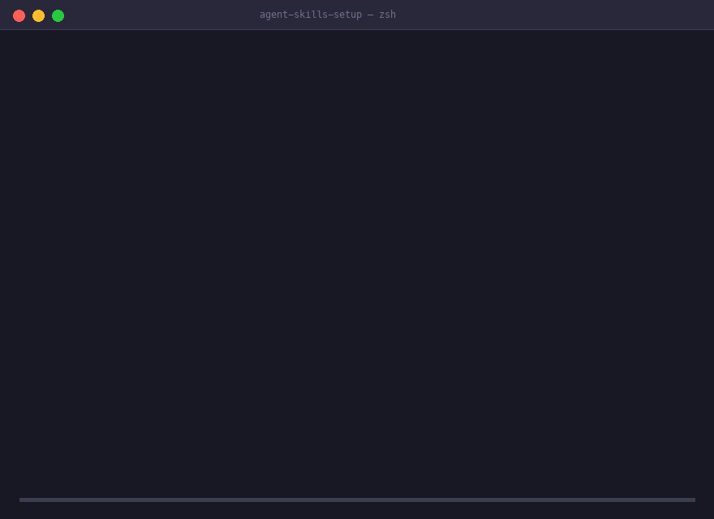

# Agent Skills Setup

> AI IDE Context Migration across Cursor, Claude Code, Codex, Cline, Windsurf, Copilot, Gemini CLI, and dozens of supported AI coding tools.

[](https://github.com/Luckycat133/skills-repo)
[](LICENSE)
[](skills/agent-skills-setup/references/ides/openclaw.md)

> Languages: **English** · [中文](README.zh-CN.md) · [日本語](README.ja-JP.md) · [Español](README.es.md)

Version: **0.10.2**. See the [release changes](CHANGELOG.md#0102---2026-10-03). GitHub installation pins `v0.10.2`.

Offline, previewed, and rollback-safe migration of AI coding context (Skills, Rules, Instructions, and MCP) across **Cursor, Claude Code, Codex, Cline, Windsurf, Copilot, Gemini CLI**, and dozens of supported AI coding tools.



---

## ⚡ Quick Install

Install `agent-skills-setup` via ClawHub / OpenClaw:

```bash
openclaw skills install @luckycat133/agent-skills-setup
```

Or install directly from GitHub:

```bash
git clone --depth 1 --branch v0.10.2 https://github.com/Luckycat133/skills-repo.git

openclaw skills install \
  ./skills-repo/skills/agent-skills-setup \
  --as agent-skills-setup
```

---

## 💬 Say this to your agent

> *"Migrate Skills, rules, and MCP from Cursor in this project to Claude Code."*

> *"I am switching computers. Back up all portable AI coding setup from my installed IDEs."*

> *"Restore this ACB bundle to the installed IDEs on my new computer."*

The current development tree adds a self-contained computer-switching handoff;
these additions are listed under [Unreleased](CHANGELOG.md#unreleased) and are
not part of the pinned `v0.10.2` installation above. The agent records the user's
selected clients with `discover-context-sources.py`, which defaults to user
configuration; project/local context requires explicit selection. Project Skills
normally return with their repositories; verify unsynced changes separately. It reviews
its scope, then runs `device-export.py --spec <scope.json> --output <fresh-packet>`.
Selected clients without native adapters retain scanned material that
`review-restore.py` can merge or copy through explicit destination mappings,
with saved plans, local backups, verification and rollback. Resolve reported
omissions before retiring the old computer.
Shared Hook definitions, notification bindings and bounded script dependencies
are captured separately from trust state. Restoration requires native definition
and dependency review; repository audit distinguishes an existing remote from
actually synchronized local configuration.
Additional adapters preserve selected disabled-Skill arrays, identity-keyed
preferences, marketplace/version inventories and inert shell-routing snippets.
Consequential behavior and installation provenance require target-native review.
For explicitly reviewed linked Skills, `prepare-skill-source.py` creates a
scanned staging source and exclusion report without changing the live tree.
For a device packet with `device-index.json` and `PACKET-SHA256.json`, the
destination AI uses its bundled `skill/scripts/device-restore.py` to verify,
list same-product recipes, save a plan and replay that reviewed plan. Project
recipes require an explicit destination workspace. See the
[device workflow](skills/agent-skills-setup/references/bundle-workflow.md).

---

## 🛡️ Migration Boundary

| Tier | Items | Behavior |
|---|---|---|
| **Automatic** | Skills, Instructions/Rules (`CLAUDE.md`, `.cursorrules`), Local stdio MCP | Verified copy for Skills, semantic conversion for instructions, and supported local stdio MCP subset conversion. |
| **Explicit Opt-in** | Plugin package copy (`--include-plugins`), Session handoff summary (`--include-session`) | Preserved with structured whitelisting and consent. |
| **Review Copies** | Eligible standalone Prompts, Commands, Agents, Hooks, Workflows; allowlisted preferences; supported MCP definitions and Codex provider/profile fields | `snapshot --include-review-materials` saves scanned reconstruction material under `objects/review/`. The destination AI reviews and merges supported native fields. No automatic settings merge, connection or activation. |
| **Mapped Reconstruction** | Selected captured Skills/text, JSON/JSONC/TOML/YAML preference fields and complete MCP definitions | `review-restore.py` binds explicit target mappings to a saved plan, preserves unrelated settings/credentials, verifies file changes and supports local rollback. Native loading and runtime require separate acceptance. |
| **Manual Checklist** | Remote MCP (HTTP/SSE), Cloud/UI configurations, other settings, dependencies, extension IDs/versions, paths, unsupported surfaces and tools | Records next actions and acceptance tasks; source inventories/exports may still be needed before leaving the old device. |
| **Never Moved** | API keys, OAuth tokens, credentials, trust state, raw chat history, generated memory | Strict secret scanning, subobject isolation, and fail-closed exclusions. Literal credentials are rejected or redacted before migration. |

---

## 🚀 Capabilities

- **`migrate`**: Inspect the selected products, save a plan, apply it, and verify the results.
- **`snapshot`**: Capture an atomic, portable **Agent Context Bundle (ACB)** with 1:1 manifest file binding, a coverage report (`recovery.json`), and a destination-agent guide (`NEXT-AGENT.md`). Optional `--include-review-materials` retains source material for manual reconstruction.
- **`restore`**: Dual-side restore planning from ACB bundles onto newly installed target tools with TOCTOU state guards.
- **`bundle-keygen`, `bundle-sign` & `bundle-verify`**: Generate Ed25519 keys, sign ACB bundles, and verify integrity with a trusted public key.
- **`doctor`**: Inspect bundle requirements and missing dependencies offline.
- **`prepare-skill-source.py`**: Materialize linked Skill packages from explicitly reviewed roots into a fresh staging tree; preserve a provenance/exclusion report for the subsequent snapshot.
- **`device-export.py`**: Capture exactly the selected clients and workspaces, bundle the offline runtime, and seal native captures, review material and next-agent instructions with checksums.
- **`capture-review-sources.py`**: Collect explicitly selected Skills, standalone context, MCP definitions and safe preference fields into inert review material, including clients without native adapters.
- **`device-restore.py`**: Verify a device packet and execute one explicit same-product `plan` / saved-plan `apply` recipe with external state and manifest verification.
- **`discover-context-sources.py`**: Produce a scope from explicitly selected clients and workspaces, preserving namespace Skills, link provenance and unresolved native/cloud sources.
- **`review-restore.py`**: Generate destination mappings, plan reviewed field/file restoration, apply atomically with backups, verify and roll back without executing captured code. See [mapped restoration](skills/agent-skills-setup/references/review-restoration.md).

Another agent can recover from the complete ACB directory and an installed copy
of this Skill without the original chat. It verifies the bundle, reads the
handoff, installs matching tools separately, and previews an explicit restore
per destination profile. Recovery tasks and results distinguish file writes,
native IDE discovery, and actual runtime/connectivity. Keep working checklist
updates outside the checksummed bundle.
Tasks distinguish `agent-review` reconstruction from `user-auth` input such as
login, keys, 2FA and native trust decisions. The AI handles supported local
file merges and path repair; missing software goes to an already-authorized
installation workflow. These offline helpers install nothing.

ACB is a partial configuration backup. It does not capture every IDE setting,
install models/dependencies, transfer accounts or credentials, or preserve raw
chats/generated memory/trust. One selected workspace does not cover other
projects. See the [computer-switching checklist](skills/agent-skills-setup/references/bundle-workflow.md)
for what to capture separately and how a new agent continues.

ACB captures ordinary file permissions, including executable bits, and still
reads older bundles without permission metadata. Saved restore plans bind to
their bundle identity; MCP previews list added, removed, and changed servers
without credential values. Instruction/MCP conversions with reported losses
are deferred until explicitly accepted. `doctor` reports package, extension,
platform, and manual-install requirements alongside executable checks.

Use `detect` and `inventory` for discovery, `plan` for a saved preview,
`apply` for the reviewed plan, and `verify` / `rollback` for evidence and
recovery. See the [command guide](skills/agent-skills-setup/references/cli-workflow.md)
for complete examples and the [compatibility matrix](docs/agent-skills-setup/compatibility-matrix.md)
for each profile's tested scope. Remote MCP and cloud settings produce manual
rebuild actions. Plugin and handoff transfer each require their explicit opt-in.
Supported JSON/JSONC and Codex TOML MCP review does not expand automatic MCP
writers. Codex provider review preserves only allowlisted connection/profile
fields with credential redaction; it copies neither the whole config nor model
weights. Native schema, account access and an actual model/tool request still
need destination verification.

---

## 🌟 Support the Project

If Agent Skills Setup saved you setup or computer-switching time, please ⭐ **Star this repository on GitHub** to help other developers discover it!

You can also sponsor development through [GitHub Sponsors](https://github.com/sponsors/Luckycat133) or [Afdian / Ko-fi](https://afdian.com/a/Luckycat133).

---

## Layout

```text
skills-repo/
├── docs/                         # Maintainer guidance & release checklists
├── scripts/                      # Repository tooling
└── skills/agent-skills-setup/    # Canonical publishable skill
    ├── SKILL.md                  # Skill descriptor & entry point
    ├── references/               # Profile registry v2 & format adapters
    └── scripts/                  # Context migrator core & ACB engine
```

## Develop & Validate

1. Edit `skills/agent-skills-setup/`, never the generated root repository pointer.
2. Regenerate the root pointer after canonical-skill edits: `bash scripts/sync-root-mirror.sh`.
3. Run `bash validate-all.sh`.
4. Merge only after all validation passes.

For isolated scale testing, run `python3 scripts/benchmark-scale.py --sizes 10,100,1000`.
It checks migration, saved-plan restore, exact contents, and rollback; timings
are observations, not CI thresholds. Add `--report /path/to/new-report.json`
and `--keep-workspace` to retain evidence. No real agent configuration is used.

The new helper regressions use isolated filesystem and packet fixtures. Packet
checksums, successful CLI restoration and manifest verification establish their
respective file-level results; they do not establish that an IDE on another Mac
discovers the configuration, authenticates or runs the intended model/MCP.

## Project

- [Changelog](CHANGELOG.md)
- [Release checklist](docs/agent-skills-setup/release-checklist.md)
- [Contributing](CONTRIBUTING.md)
- [Security](SECURITY.md)
- [Code of conduct](CODE_OF_CONDUCT.md)
- [License](LICENSE)
